# dsh-preview-extra — DSH 右侧栏文档预览扩展

给 DSH（DeepSeek Harness 0.2.0-rc.2）右侧栏的**文档预览**增加这些格式：
**3D 模型（STL/OBJ/PLY/glTF/GLB）**、**压缩包（zip/tar/gz）**、**音视频**、**字体**、**字幕**、
**TOML**、**Intel HEX**、**JCAMP-DX**、**VCD**、**KiCad 原理图/电路板**、**DFU**。
纯客户端插件、零第三方依赖、无网络请求；所有预览都注册进内置的
`@deepseek-ai/dsh-client-ui-sidebar-documentpreview` 文档 tab，与内置的
Markdown / 代码 / 图片 / PDF / Office 预览共享同一套打开方式、路径头、刷新与「打开方式」菜单。

本仓库根目录就是可安装的 DSH 插件包（`package.json` + `lib/` + `cordis.patch.yml`），
因此可以直接在 DSH 的「添加插件」里用 GitHub 仓库地址安装。发布包在
[v0.1.0](https://github.com/LeiYuXingZhou/dsh-preview-extra/releases/tag/v0.1.0)。

## 状态

| 项目 | 结果 |
| --- | --- |
| 版本 | `0.1.0`（[GitHub Release](https://github.com/LeiYuXingZhou/dsh-preview-extra/releases/tag/v0.1.0)） |
| 构建产物 | `lib/client.js`（约 362 KiB，24 个内部模块，单文件 classic script） |
| 契约静态校验 | `skeleton/verify.mjs` → **34/34** |
| 组装后冒烟（假 React + 假 Cordis ctx） | `tools/smoke.mjs` → 全部通过（每个预览正文都能挂上） |
| 解析器单测 | 3D **38/38**、压缩包 **28/28**、新格式 **13/13** |
| 真实 GUI E2E（无头 Chrome + CDP） | STL / GLB、ZIP 条目树与条目文本、WAV、SRT、7z 提示、TOML、Intel HEX、JCAMP-DX、VCD、KiCad 原理图与电路板、DFU —— 截图见 `shots/` |

## 新增支持的格式

| 类别 | 后缀 | 预览内容 |
| --- | --- | --- |
| 3D 模型 | `stl`（ASCII/二进制）、`obj`、`ply`（ASCII / binary_little_endian）、`gltf`、`glb` | Canvas2D 软件渲染：拖拽旋转、滚轮缩放、右键/Shift 平移、双击复位、线框开关、包围盒/三角形/顶点统计；glTF/GLB 读取内嵌 buffer 和节点变换；>30 万三角形自动抽样降级 |
| 压缩包 | `zip`、`jar`、`war`、`apk`、`tar`、`gz`、`tgz`、`tar.gz` | 条目树（名称/大小/时间/方法），点击条目查看文本（带行号，最多 200KB）、图片、或二进制说明；GBK 文件名兜底；防 zip bomb 限额 |
| 压缩包（仅识别） | `7z`、`rar`、`xz`、`bz2`、`zst` | 显示格式与"请先解压为 zip/tar"的提示（浏览器端没有对应解压 API） |
| 音频 | `mp3`、`wav`、`ogg`、`oga`、`m4a`、`aac`、`flac`、`opus` | 原生 `<audio>` 播放器；显示大小/MIME |
| 视频 | `mp4`、`webm`、`m4v`、`mov`、`mkv` | 原生 `<video>` 播放器；显示大小/MIME |
| 字体 | `ttf`、`otf`、`woff`、`woff2` | FontFace 加载后的样张：中英文 pangram、大小写字母表、标点、字号阶梯 |
| 字幕 | `srt`、`vtt`、`ass`、`ssa` | 时间轴字幕列表（起止时间 + 文本）、条数/编码/总时长，可切换原始文本 |
| TOML | `toml` | 按表展开的键、类型和值；支持数组、内联表、`[表]` 和 `[[表数组]]` |
| Intel HEX | `hex` | 记录校验、线性/段地址合并、入口地址，以及按地址分段的十六进制转储 |
| JCAMP-DX | `jdx`、`dx` | 谱图折线（`(X++(Y..Y))`、峰表、PAC 压缩）和表头 |
| VCD | `vcd` | 数字波形：时间刻度、作用域、0/1/x/z 和总线值 |
| KiCad | `kicad_sch`、`kicad_pcb` | 原理图（导线、符号、针脚）或电路板（走线、过孔、焊盘、板框）；滚轮缩放、拖拽平移 |
| DFU | `dfu` | USB DFU 后缀（厂商/产品 ID、版本、CRC）和 DfuSe 多镜像的地址与大小 |

打开方式：右侧栏「文件」tab 里点任意文件；聊天里的文件卡片、交付物卡片也会走同一预览。

## 截图（真实 GUI，无头 Chrome + CDP 驱动）

| 3D 模型（STL） | 压缩包条目树 |
| --- | --- |
| 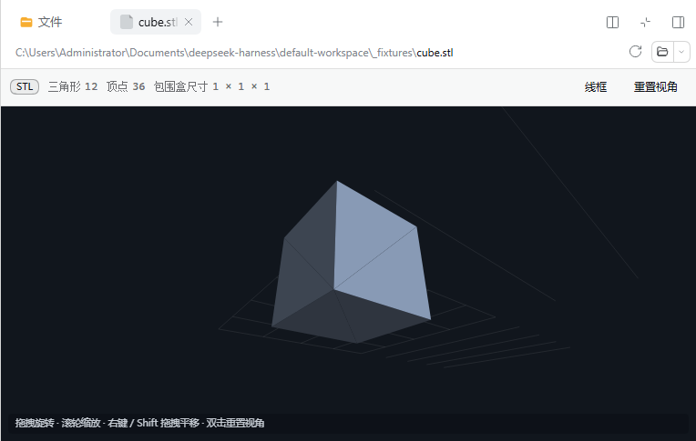 | 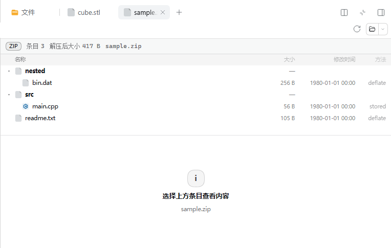 |

| ZIP 内条目文本 | 音频播放器 |
| --- | --- |
| 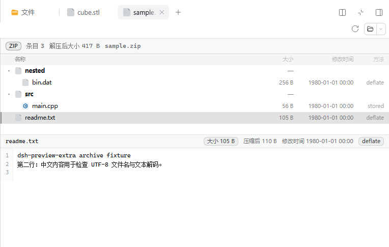 | 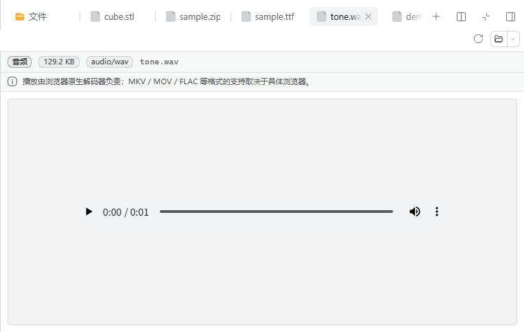 |

| SRT 字幕 | 7z 不支持提示 |
| --- | --- |
| 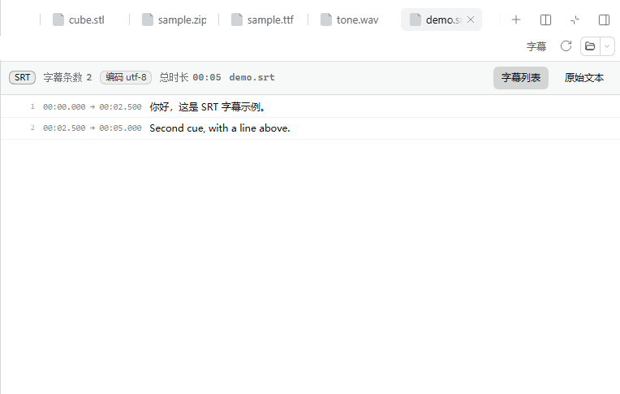 | 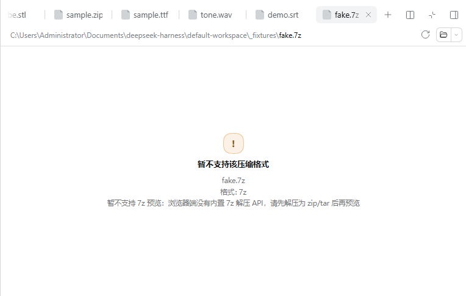 |

| 3D 模型（GLB） | TOML |
| --- | --- |
| 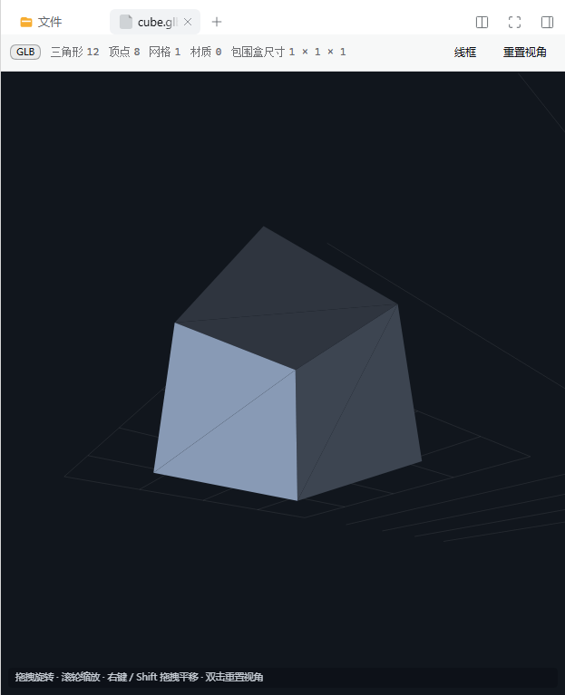 | 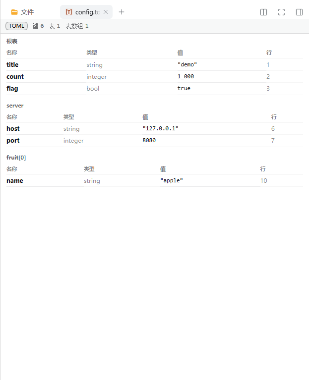 |

| Intel HEX | JCAMP-DX |
| --- | --- |
|  | 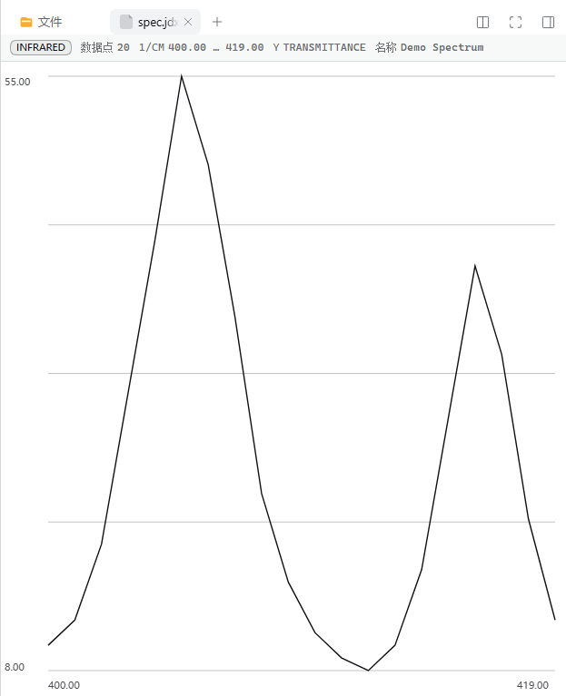 |

| VCD 波形 | KiCad 原理图 |
| --- | --- |
| 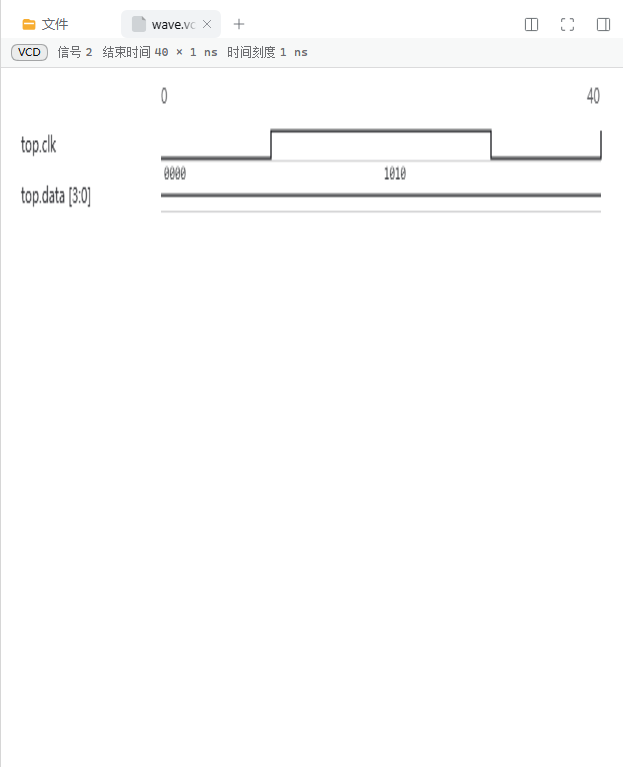 | 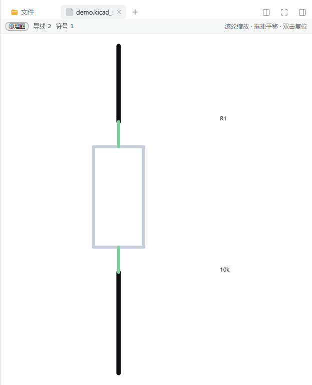 |

| KiCad 电路板 | DFU |
| --- | --- |
| 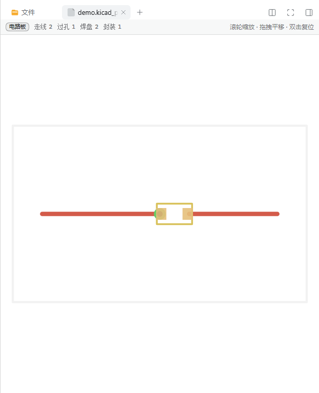 | 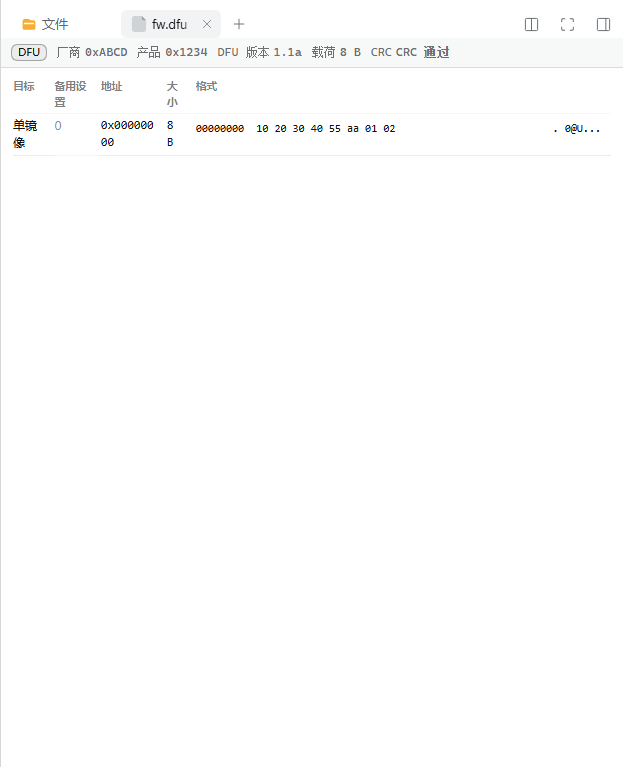 |

## 目录

```
dsh-preview-extra/
  package.json          ← 插件包清单：dsh.client 声明（platform=web、exports["./client"]、inject 提示）
  cordis.patch.yml      ← bundle patch：安装后自动插入 Loader 行
  lib/index.js          ← 宿主半侧：no-op cordis 插件（全部逻辑在浏览器侧）
  lib/client.js         ← 构建产物（scripts/build-client.mjs 生成，不要手改）
  src/client/main.js    ← 浏览器入口：按 previewDefinitions 注册 preview + keyed body + locale + 样式
  src/ui/views.js       ← 原有预览组件 + 中英文案 + CSS + previewDefinitions
  src/ui/extra-views.js ← TOML / Intel HEX / JCAMP-DX / VCD / KiCad / DFU 正文
  src/formats/          ← 上述格式和 glTF/GLB 的纯解析器
  src/model/            ← STL/OBJ/PLY/glTF 网格 + Canvas2D 软件渲染器（纯 ESM，无 DOM 顶层依赖）
  src/archive/          ← zip/tar/gzip 解析 + 魔数识别 + 限额（纯 ESM，无 Node API）
  scripts/build-client.mjs ← 手写"打包器"：把 src/** 的 ESM 拼成 __ModuleLoader__.load 的 factory
  scripts/install.mjs   ← 安装/卸载到任意 profile（复制包 + 追加 patch 行）
  tools/smoke.mjs       ← 无浏览器冒烟：加载真实 bundle 并渲染每个预览正文
  tools/cdp.mjs         ← 无头 Chrome CDP 驱动（导航/求值/截图）
  tools/probe-bundle.mjs← 探测某个 DSH 实例是否已提供本插件 bundle
  tools/fixtures-gen.mjs← 生成 E2E 样例文件（STL/OBJ/PLY/ZIP/TAR/GZ/WAV/SRT…）
  notes/                ← 逆向文档：module-contract.md（客户端插件契约）、preview-api.md（预览扩展契约）
  skeleton/             ← 手写客户端插件最小骨架 + verify.mjs 契约校验器（来自契约调研）
  shots/                ← E2E 截图
```

`_fixtures/`（样例文件）与 `_dsh_test/`（隔离测试用 DSH_HOME）属于本地测试产物，已在 `.gitignore` 中排除，
需要时用 `tools/fixtures-gen.mjs` 重新生成。

## 通过 DSH 安装

DSH 的「设置 → 插件 → 添加插件」支持**包名 / GitHub 仓库地址 / 本地目录路径**三种来源。本仓库根目录
就是包，因此：

1. 打开 DSH → 设置 → 插件 → **添加插件**；
2. 粘贴 GitHub 仓库地址：

   ```
   https://github.com/LeiYuXingZhou/dsh-preview-extra
   ```

3. 点「安装」。装完后 profile 的 `cordis.patch.yml` 会由本包的 `cordis.patch.yml`（`dsh.bundle.patch`）
   自动挂载 Loader 行，页面刷新即生效（不需要重启 DSH）。

本机注意事项：

- 当前网络直连 `github.com:443` 不通，需要给 git 配代理后再装：`git config --global http.proxy http://127.0.0.1:7877`
- 或者直接用**本地目录路径**安装（绝对路径，指向本仓库根目录）：

  ```
  C:\Users\Administrator\Documents\daily\dsh-preview-extra
  ```

- 也可以手动安装（本仓库自带脚本，复制包 + 追加 patch 行，幂等）：

  ```powershell
  & 'C:\Program Files\nodejs\node.exe' .\scripts\install.mjs --profile-dir "$env:USERPROFILE\.dsh\profiles\desktop"
  ```

## 快速使用

1. 在 DSH 右侧栏点「文件」tab（或聊天里的文件/交付物卡片）；
2. 点开以下任意文件即可看到新预览：`.stl`、`.obj`、`.ply`、`.gltf`、`.glb`、`.zip`、`.tar`、`.tar.gz`、
   `.mp3`/`.wav`/`.mp4`/`.webm`、`.ttf`/`.otf`/`.woff2`、`.srt`/`.vtt`/`.ass`、
   `.toml`、`.hex`、`.jdx`、`.dx`、`.vcd`、`.kicad_sch`、`.kicad_pcb`、`.dfu`；
3. `.7z`/`.rar`/`.xz`/`.bz2`/`.zst` 会显示"暂不支持，请先解压为 zip/tar"的提示。

## 重新构建 / 手动安装 / 回滚

```powershell
$node = 'C:\Program Files\nodejs\node.exe'
& $node .\scripts\build-client.mjs                       # 改过 src 后重新打包
& $node .\tools\smoke.mjs                                # 组装后冒烟
& $node .\skeleton\verify.mjs .                          # 契约静态校验（34/34）
& $node .\scripts\install.mjs --profile-dir "$env:USERPROFILE\.dsh\profiles\desktop"           # 安装
& $node .\scripts\install.mjs --profile-dir "$env:USERPROFILE\.dsh\profiles\desktop" --uninstall # 卸载
```

`desktop` profile 的原始 patch 备份：`~/.dsh/profiles/desktop/cordis.patch.yml.bak-before-preview-extra`。

## 开发

常用命令：

```powershell
& 'C:\Program Files\nodejs\node.exe' .\scripts\build-client.mjs          # 构建 lib/client.js
& 'C:\Program Files\nodejs\node.exe' .\src\model\tests\run.js            # 38 项 3D 测试
& 'C:\Program Files\nodejs\node.exe' .\src\formats\tests\run.mjs         # TOML / HEX / glTF / JCAMP / VCD / KiCad / DFU
& 'C:\Program Files\nodejs\node.exe' .\src\archive\tests\run-tests.mjs   # 28 项压缩包测试
& 'C:\Program Files\nodejs\node.exe' .\src\ui\smoke.mjs                  # UI 冒烟（假 React）
& 'C:\Program Files\nodejs\node.exe' .\tools\smoke.mjs                   # 组装后的 bundle 冒烟
& 'C:\Program Files\nodejs\node.exe' .\skeleton\verify.mjs .             # 契约静态校验
```

## 实现要点

- 浏览器 bundle 是**手写的 classic script**：`window.__ModuleLoader__.load({ id, factory })`，
  `id` 必须等于包名；`factory(require)` 里只 `require` 平台冻结表（react / react-dom /
  `@deepseek-ai/dsh-client-ui-primitives` 等 9 个 key），不引入任何动态包。
- 硬依赖只有 `slots` 服务；`documentPreviews` 与 `locale` 用 `ctx.inject([...])` 软等待——
  这样即使内置文档预览被禁用，本插件也只是休眠，不会把整页启动拖垮（DSH 页面 boot 是"全有或全无"）。
- 每个格式族的注册都是两处：`ctx.documentPreviews.register({ id, extensions, binaryExtensions,
  priority, title, loading, wrap })` + `ctx.slots.register("sidebar.right.tab.document", { key: id })`，
  两处都用同一个 id，且都包在 `ctx.effect` 里以便 HMR 回收。
- 全部解析器都是纯 JS / Web 标准 API（`DecompressionStream`、`TextDecoder`、`FontFace`、Blob URL），
  没有 Node 内置模块，也没有第三方依赖。

## 测试用 DSH 实例（E2E）

```powershell
$env:DSH_HOME = 'C:\Users\you\Documents\daily\_dsh_test'
& 'C:\Program Files\nodejs\node.exe' 'C:\Users\you\.dsh\acl-runner\node_modules\@deepseek-ai\dsh\lib\bin.js' --profile test --no-open --port 1891
# 终端会打印带 token 的 URL；无头 Chrome 已可用 CDP 驱动：
& 'C:\Program Files\nodejs\node.exe' .\tools\cdp.mjs new "<带 token 的 URL>"
& 'C:\Program Files\nodejs\node.exe' .\tools\cdp.mjs eval "document.body.innerText.slice(0,500)"
& 'C:\Program Files\nodejs\node.exe' .\tools\cdp.mjs shot .\shots\screen.png
```

## 已知限制

- 完整字节加载受宿主 32 MiB 上限；超大文件走内置"无法预览/本地打开"。
- 压缩包：5000 条目 / 单条目 32 MB / 累计 128 MB 限额；文本条目最多 200 KB。
- 7z/rar/xz/bz2/zst 仅识别提示；分卷 ZIP、加密 ZIP 条目不可读（显示原因）。
- 音视频编解码依赖浏览器；MKV/MOV 视编码而定。
- 3D：Canvas2D 软件渲染，无 WebGL；>30 万三角形自动降级；PLY 仅 little-endian。glTF/GLB 只画三角形（点/线会跳过），外部 `.bin`、蒙皮和动画不会套用。不支持 3MF/FBX/STEP。
- Intel HEX 按记录合并地址空间，单段转储只显示开头一段。
- JCAMP-DX 不展开 NTUPLES 多页；压缩编码支持 SQZ/DIF/DUP。
- VCD 最多画 40 条信号，超长跳变会截断。
- KiCad 是几何预览：不跑 ERC/DRC，不展开封装焊盘网表，复杂板会限制图元数量。
- DFU 展示镜像布局和 CRC，不模拟烧录。
- 字幕：ASS/SSA 样式与定位忽略；1 MB / 3000 条上限。
- 字体：不解析字形表；TTC 可能加载失败。
